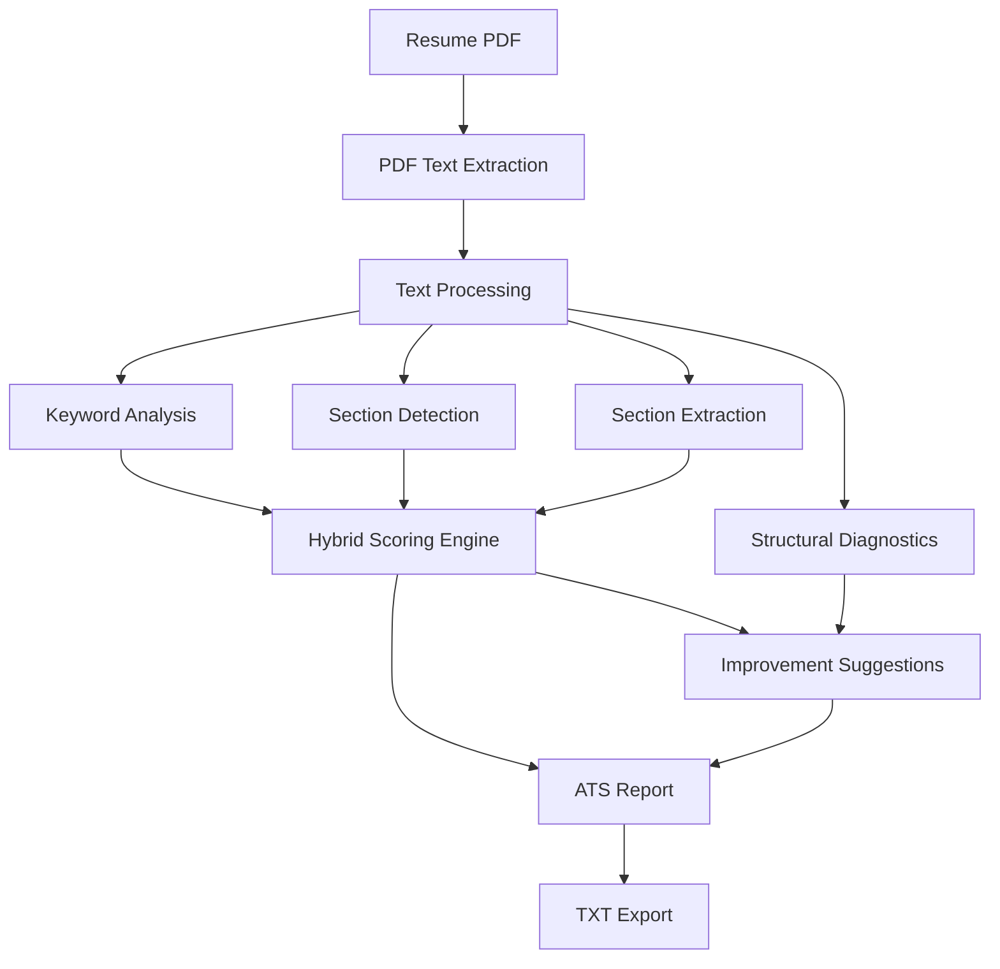
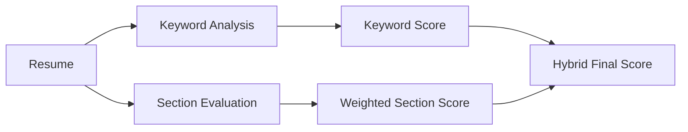
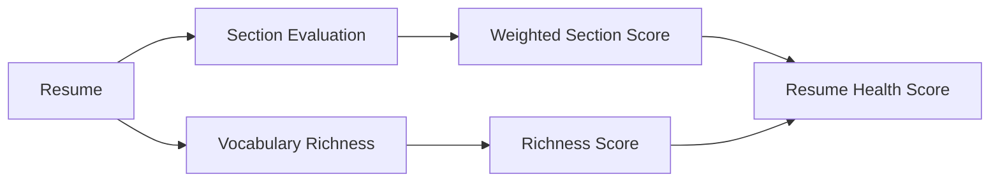
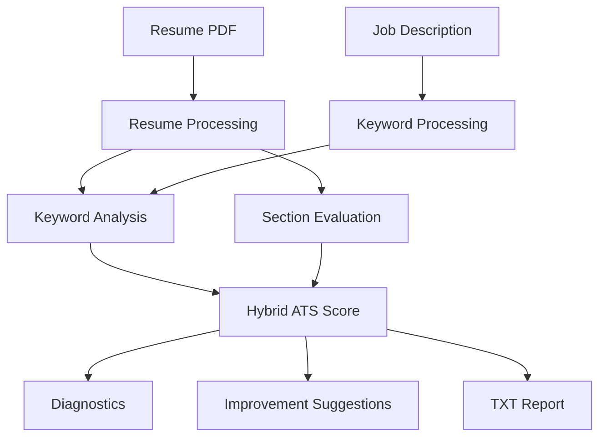
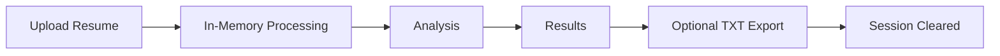

# resumd

> A privacy-first, explainable ATS resume analyzer built with deterministic algorithms.

<p align="center">
  <a href="https://resumd.streamlit.app">
    
  </a>
</p>

<p align="center">


</p>

---

# Overview

**resumd** is an open-source Applicant Tracking System (ATS) resume analyzer designed around a simple principle: **resume analysis should be transparent, reproducible, and privacy-conscious.**

Unlike many resume scanners that rely on opaque scoring systems or external AI services, resumd uses deterministic algorithms that produce consistent results for the same input every time. Every score, recommendation, and diagnostic can be traced back to explicit rules implemented in the source code.

The application supports two complementary analysis modes:

- **Full Audit** — evaluates a resume against a job description using a hybrid scoring model that combines keyword relevance with section-level quality.
- **Resume Health Check** — evaluates the resume independently, providing structural analysis, section quality scores, formatting diagnostics, and improvement recommendations without requiring a job description.

The current scoring architecture combines two independent evaluation pipelines:

- **Keyword Analysis** — measures how well the resume aligns with a target job description.
- **Section Evaluation** — measures the quality of individual resume sections using deterministic benchmarks and weighted scoring.

These pipelines are merged into a single explainable score, providing a more balanced assessment than keyword matching alone while remaining fully deterministic.

### Design Principles

- 🔒 Privacy-first processing
- 📖 Explainable scoring
- ⚙️ Deterministic algorithms
- 📊 Reproducible results
- 🧩 Modular architecture
- 🌐 Fully open source

---

# Features

| Feature | Description |
|----------|-------------|
| **Hybrid ATS Scoring** | Combines keyword matching with weighted section evaluation for a balanced final score. |
| **Full Audit** | Compares a resume against a job description to measure ATS compatibility and identify improvement opportunities. |
| **Resume Health Check** | Evaluates a resume independently without requiring a job description. |
| **Section Extraction** | Extracts the content belonging to major resume sections before evaluation. |
| **Section Detection** | Detects common ATS sections including Experience, Skills, Projects, Education, Summary, Certifications, and Achievements. |
| **Section-wise Scoring** | Scores each section individually based on deterministic quality metrics. |
| **ATS Benchmarks** | Compares section performance against predefined benchmark values used throughout the scoring engine. |
| **Keyword Analysis** | Calculates keyword coverage, Jaccard similarity, matched keywords, and knowledge gaps. |
| **Formatting Diagnostics** | Detects common ATS compatibility issues such as missing contact information, scanned PDFs, excessive decorative characters, and possible multi-column layouts. |
| **Resume Health Metrics** | Evaluates vocabulary richness, section quality, and overall resume structure. |
| **Improvement Suggestions** | Generates recommendations using keyword gaps, structural diagnostics, and section-level performance. |
| **Plain Text Report Export** | Exports the complete analysis as a `.txt` report without storing resume data. |
| **Explainable Scoring** | Every score is derived from deterministic calculations rather than probabilistic AI models. |
| **Privacy-first Processing** | Resume files are processed in memory without persistent storage or external processing APIs. |
| **Session Purge** | Clears all session data immediately with a single action. |
| **Interactive Dashboard** | Presents overall scores, section breakdowns, diagnostics, keyword statistics, and visual performance summaries. |
| **Section Performance Visualization** | Displays section scores alongside predefined ATS benchmark values for easier interpretation. |

### Analysis Modes

| Mode | Purpose |
|------|---------|
| **Full Audit** | Resume + Job Description analysis using hybrid ATS scoring. |
| **Resume Health Check** | Resume-only analysis focused on structure, quality, and ATS readiness. |

### Core Principles

- Deterministic scoring for reproducible results.
- No machine learning or LLM-generated evaluations.
- No external processing services.
- Transparent scoring methodology.
- Modular analysis pipeline.
- Open-source implementation.

# Architecture

resumd follows a modular analysis pipeline built around deterministic processing. Every stage performs a specific task and produces intermediate results that are used by the subsequent stages. This separation keeps the scoring process transparent, reproducible, and easy to audit.



## Processing Pipeline

### 1. PDF Extraction

The uploaded resume is parsed using **PyMuPDF**, extracting machine-readable text directly from the PDF. Image-based or scanned PDFs are detected and reported because they cannot be reliably parsed by most Applicant Tracking Systems.

---

### 2. Text Processing

The extracted text is normalized before analysis.

This stage performs:

- Lowercase normalization
- Punctuation cleanup
- Stop-word removal
- Lightweight stemming
- Token generation

These normalized tokens become the common representation used throughout the analysis pipeline.

---

### 3. Keyword Analysis

When a job description is provided, the application compares resume tokens with job description tokens to compute:

- Keyword Coverage
- Jaccard Similarity
- Matched keywords
- Missing keywords

This measures how closely the resume aligns with the vocabulary used in the target role.

---

### 4. Section Analysis

Rather than only checking whether a section exists, the application extracts the text belonging to each detected section and evaluates it independently.

Supported sections include:

- Experience
- Skills
- Projects
- Summary
- Education
- Certifications
- Achievements

Each section receives its own ATS score before contributing to the overall evaluation.

---

### 5. Structural Diagnostics

The resume is inspected for formatting characteristics that commonly affect ATS parsing.

Diagnostics include checks for:

- Resume length
- Missing email address
- Missing phone number
- Quantifiable achievements
- Decorative characters
- Possible multi-column layouts
- Image-based PDFs

---

### 6. Hybrid Scoring Engine

The outputs of the keyword analysis and section evaluation pipelines are merged into a single weighted score.

Instead of relying solely on keyword overlap, the final score reflects both:

- relevance to the target job description
- quality of the resume's individual sections

This hybrid architecture produces a more balanced assessment while remaining completely deterministic.

---

### 7. Report Generation

After analysis completes, the application generates:

- Overall ATS score
- Section breakdown
- Keyword matches
- Keyword gaps
- Formatting diagnostics
- Improvement suggestions

The complete report can then be exported as a plain text (`.txt`) file.

---

# How Hybrid ATS Scoring Works

resumd intentionally separates **relevance** from **resume quality**.

Rather than relying on a single keyword score, two independent evaluation pipelines are executed and combined into the final ATS score.



## Step 1 — Keyword Analysis

When a job description is supplied, the application first measures how closely the resume matches the target role.

Two metrics are calculated.

### Keyword Coverage

Measures how many unique job description keywords appear in the resume.

```text
Coverage = Matched JD Keywords / Total JD Keywords
```

---

### Jaccard Similarity

Measures vocabulary overlap while accounting for both shared and unique keywords.

```text
Jaccard = Intersection / Union
```

---

### Keyword Score

The two metrics are blended before being scaled.

```text
Keyword Raw Score

= (0.70 × Coverage)

+ (0.30 × Jaccard)
```

A square-root transformation is then applied.

```text
Keyword Score

= √(Keyword Raw Score) × 98
```

The display score is intentionally capped at **98** rather than **100**, avoiding unrealistically perfect ATS scores.

---

## Step 2 — Section Evaluation

Each detected resume section is evaluated independently.

Every section is scored using three deterministic signals:

- Section presence
- Content density
- Job description relevance (when available)

The individual section scores are then combined using predefined weights.

| Section | Weight |
|----------|--------:|
| Experience | 30% |
| Skills | 25% |
| Projects | 20% |
| Summary | 10% |
| Education | 8% |
| Certifications | 4% |
| Achievements | 3% |

This produces a weighted section quality score that reflects the overall strength of the resume structure.

---

## Step 3 — Final Hybrid Score

The final ATS score combines both independent evaluation pipelines.

```text
Final Score

= (0.60 × Section Score)

+ (0.40 × Keyword Score)
```

This design rewards resumes that are both:

- structurally strong
- relevant to the target job description

instead of emphasizing keyword overlap alone.

---

## Why a Hybrid Model?

Keyword matching alone cannot distinguish between:

- a well-structured resume
- a poorly organized document filled with copied keywords

By evaluating section quality separately, the scoring process rewards resumes that contain meaningful content in the places recruiters and ATS systems expect.

The result is a scoring model that remains deterministic while providing a more balanced assessment of ATS compatibility.

---

# Section Evaluation Engine

One of the core improvements in resumd is its dedicated section evaluation engine.

Instead of simply checking whether common resume headings exist, the application extracts the content belonging to each detected section and evaluates that content independently.

## Supported Sections

| Section | Purpose |
|----------|---------|
| Experience | Professional work history |
| Skills | Technical skills and competencies |
| Projects | Personal or professional projects |
| Summary | Professional introduction |
| Education | Academic background |
| Certifications | Professional certifications and credentials |
| Achievements | Awards and notable accomplishments |

---

## Section Extraction

The application scans the resume for common section headings.

Once a section is detected, the text between that heading and the next detected section is extracted for analysis.

Each extracted section is evaluated independently rather than treating the resume as a single block of text.

---

## Section Scoring

Every detected section receives a score on a 0–98 scale.

The score is determined using deterministic rules.

### Section Presence

A missing section receives a significant penalty because common ATS-friendly resumes are expected to include standard sections.

---

### Content Density

The application evaluates the amount of meaningful vocabulary contained within the section.

Sections with richer, more informative content receive higher density scores.

---

### Job Description Alignment

When a job description is available, each section is also evaluated based on its overlap with relevant job description keywords.

This allows the application to identify which parts of the resume align well with the target role and which may require improvement.

When no job description is provided, this component instead contributes using section richness, allowing Resume Health Check mode to evaluate resumes independently.

---

## ATS Benchmarks

Each section is compared against predefined benchmark values representing the expected quality of a strong ATS-friendly resume.

| Section | Benchmark |
|----------|-----------:|
| Experience | 85 |
| Skills | 90 |
| Projects | 80 |
| Education | 75 |
| Summary | 70 |
| Certifications | 65 |
| Achievements | 70 |

These benchmarks are used as reference values throughout the visualization layer, allowing users to compare their section performance against expected ATS targets.

---

## Why Evaluate Sections Separately?

Treating an entire resume as one block of text often hides important weaknesses.

For example:

- a resume may contain excellent skills but weak project descriptions
- work experience may be detailed while certifications are missing
- keyword coverage may be high despite poor section organization

Section-wise evaluation highlights these differences, producing actionable feedback while maintaining a transparent and reproducible scoring process.

# Resume Health Check

The **Resume Health Check** provides a standalone evaluation of your resume without requiring a job description.

Rather than measuring relevance to a specific role, this mode focuses on the overall quality, structure, and ATS readiness of the resume itself.

It is intended for early resume development, general improvements, or validating a resume before tailoring it to a particular position.

---

## What is Evaluated?

Resume Health Check combines two independent evaluations:

- **Section Quality** — Measures the strength of each major resume section.
- **Vocabulary Richness** — Measures the diversity of meaningful terms used throughout the resume.

These are combined into a single weighted health score.



---

## Vocabulary Richness

Vocabulary richness measures how much meaningful content exists within the resume.

Instead of simply counting words, the application removes common stop words and performs lightweight stemming before calculating the ratio of unique meaningful tokens.

The richness score is computed using a square-root scaling function.

```text
Raw Ratio

= Unique Tokens / Total Words
```

```text
Richness Score

= √(Raw Ratio / 0.65) × 98
```

A minimum floor is applied to avoid extremely low scores on small resumes, while the maximum display score remains capped at **98**.

---

## Final Health Score

The Resume Health Check combines section quality with vocabulary richness.

```text
Health Score

= (0.60 × Weighted Section Score)

+ (0.40 × Richness Score)
```

This produces a balanced evaluation that rewards both:

- well-developed resume sections
- meaningful written content

---

## Health Check Output

Resume Health Check provides:

- Overall Health Score
- Section-wise ATS scores
- Vocabulary richness statistics
- Unique token count
- Resume word count
- Structural diagnostics
- Improvement suggestions

Because no job description is required, this mode is ideal for improving a resume before tailoring it for a specific application.

---

# Full Audit

**Full Audit** evaluates a resume against a specific job description using the project's hybrid ATS scoring engine.

This mode combines keyword relevance with section-level evaluation to estimate how well the resume aligns with the target role.

Unlike a keyword-only comparison, Full Audit also considers the quality of the resume's individual sections before calculating the final score.

---

## Full Audit Workflow



---

## Keyword Analysis

When a job description is supplied, the application calculates:

### Keyword Coverage

Measures the percentage of job description keywords found within the resume.

---

### Jaccard Similarity

Measures the similarity between resume vocabulary and job description vocabulary.

---

### Keyword Matches

Displays the keywords shared between both documents.

These help users understand which important terms are already represented within the resume.

---

### Knowledge Gaps

Displays keywords that appear in the job description but not in the resume.

These gaps help identify opportunities to naturally improve alignment with the target role.

---

## Section Quality

Every detected section is evaluated independently before contributing to the final ATS score.

Each section receives an individual score based on:

- Presence
- Content density
- Job description relevance

These scores are combined using predefined section weights to produce a weighted section score.

---

## Final Report

Full Audit generates a complete ATS compatibility report including:

- Final Hybrid ATS Score
- Match tier
- Keyword Coverage
- Jaccard Similarity
- Matched keywords
- Missing keywords
- Section-wise scores
- Formatting diagnostics
- Improvement suggestions

The complete report can be exported as a plain text (`.txt`) file for future reference.

---

# Formatting Diagnostics

In addition to scoring, resumd performs a series of deterministic structural checks designed to identify formatting characteristics that commonly reduce ATS compatibility.

These diagnostics do not affect every score directly, but they provide actionable feedback about potential parsing issues.

---

## Diagnostic Checks

| Check | Purpose |
|--------|----------|
| **Resume Length** | Detects resumes that are significantly shorter or longer than recommended. |
| **Email Detection** | Warns when no email address is detected. |
| **Phone Number Detection** | Indicates when a phone number cannot be found. |
| **Quantifiable Achievements** | Checks for measurable accomplishments such as percentages, revenue, project counts, years, or similar numerical evidence. |
| **Decorative Characters** | Detects excessive symbols that may interfere with ATS parsing. |
| **Multi-column Detection** | Warns when high tab usage suggests a possible multi-column layout. |
| **Image-based PDF Detection** | Detects PDFs that contain little or no extractable text, indicating they may be scanned or image-based. |

---

## Severity Levels

Diagnostics are categorized by severity to help prioritize improvements.

| Level | Meaning |
|--------|----------|
| **Error** | A significant issue likely to affect ATS parsing. |
| **Warning** | A potential compatibility concern that should be reviewed. |
| **Info** | Informational feedback or confirmation that no major issues were detected. |

---

## Improvement Suggestions

After diagnostics complete, the application generates deterministic recommendations using:

- Section scores
- Missing sections
- Keyword gaps
- Resume length
- Formatting diagnostics
- Quantifiable achievement detection

Suggestions are generated from explicit rules rather than probabilistic models, ensuring that identical inputs always produce identical recommendations.

---

## Report Export

Both analysis modes support exporting results as a plain text (`.txt`) report.

The exported report includes:

- Overall score
- Section breakdown
- Keyword analysis (Full Audit)
- Diagnostics
- Improvement suggestions

Report generation is performed entirely within the current session, and no resume data is retained after the session is cleared or expires.

# Explainability

A core design goal of **resumd** is explainability.

Every score, recommendation, and diagnostic is generated using deterministic algorithms and explicit rules defined within the codebase. The application intentionally avoids opaque scoring systems, ensuring that identical inputs always produce identical outputs.

This makes the evaluation process predictable, reproducible, and easier to understand for both users and developers.

---

## Why Deterministic Scoring?

Many resume analyzers rely on probabilistic or AI-generated feedback, where the same resume can receive different results across multiple evaluations.

resumd takes a different approach.

By using deterministic algorithms, the application guarantees:

- **Consistency** — The same resume always produces the same results.
- **Transparency** — Every score can be traced back to a specific calculation or rule.
- **Reproducibility** — Results can be independently verified by inspecting the source code.
- **Debuggability** — Individual scoring components can be tested and improved without affecting unrelated parts of the system.

This philosophy makes the scoring process easier to interpret and more suitable for iterative resume improvement.

---

## Explainable by Design

The application does not generate arbitrary recommendations.

Instead, suggestions are derived from measurable signals such as:

- Missing or weak resume sections
- Keyword gaps relative to a job description
- Section benchmark performance
- Resume structure
- Formatting diagnostics
- Vocabulary richness

Each recommendation is therefore linked to an observable characteristic of the resume rather than an opaque model prediction.

---

## Transparent Scoring Pipeline

Every overall score displayed by the application is built from intermediate calculations that can be independently examined.

These include:

- Keyword Coverage
- Jaccard Similarity
- Vocabulary Richness
- Section Scores
- Benchmark Comparison
- Weighted Final Score

This layered approach allows users to understand **why** a score was assigned instead of receiving only a single numerical result.

---

## Engineering Philosophy

The project prioritizes:

- Explainability over complexity
- Reproducibility over randomness
- Privacy over external processing
- Deterministic rules over black-box predictions

The goal is not to emulate recruiter decision-making, but to provide a transparent and repeatable ATS-oriented evaluation framework that users can confidently interpret.

---

# Privacy Model

Privacy is a fundamental design principle of **resumd**.

The application is designed to analyze resumes within the active Streamlit session without permanently storing uploaded documents or sending them to third-party analysis services.

---

## Privacy Overview

| Aspect | Implementation |
|--------|----------------|
| **Resume Processing** | Performed during the active application session. |
| **Persistent Storage** | None. Uploaded resumes are not permanently stored by the application. |
| **External AI Services** | Not used for resume analysis. |
| **Deterministic Processing** | All analysis is performed using local application logic. |
| **Session Purge** | Users can clear session data at any time. |
| **Source Transparency** | All scoring logic is available in the open-source codebase. |

---

## Data Lifecycle



The application processes uploaded documents only for the duration required to generate the requested analysis.

Once the session is cleared or expires, the processed data is no longer retained by the application.

---

## No Black-Box Processing

resumd intentionally avoids external AI-powered resume evaluation services.

This provides several benefits:

- Greater transparency
- Deterministic scoring
- Consistent results
- Reduced data exposure
- Easier verification of scoring behavior

---

## Open Source Verification

Because the project is open source, users can inspect the implementation to understand:

- How scores are calculated
- Which heuristics are applied
- How recommendations are generated
- How uploaded resumes are processed

This aligns with the project's commitment to transparency and reproducibility.

---

# Tech Stack

The project is built using a lightweight Python stack focused on deterministic text processing and interactive visualization.

| Layer | Technology | Purpose |
|--------|------------|---------|
| **Language** | Python | Core application logic |
| **Framework** | Streamlit | Interactive web interface |
| **PDF Processing** | PyMuPDF (`fitz`) | Text extraction from PDF resumes |
| **Data Processing** | Python Standard Library | Tokenization, normalization, regex processing, scoring, and diagnostics |
| **State Management** | Streamlit Session State | Session-scoped analysis and user interactions |
| **Visualization** | Plotly | Interactive charts and score visualizations |
| **Documentation** | Mermaid | Architecture and workflow diagrams in this README |

---

## Core Components

| Component | Responsibility |
|-----------|----------------|
| **PDF Parser** | Extracts machine-readable text from uploaded resumes. |
| **Text Processing Engine** | Normalizes text for deterministic analysis. |
| **Keyword Analysis Engine** | Calculates coverage, similarity, matched terms, and keyword gaps. |
| **Section Extraction Engine** | Detects and extracts resume sections for independent evaluation. |
| **Section Evaluation Engine** | Scores individual sections using deterministic benchmarks. |
| **Hybrid Scoring Engine** | Combines keyword relevance and section quality into a weighted ATS score. |
| **Diagnostics Engine** | Performs formatting and structural compatibility checks. |
| **Recommendation Engine** | Generates rule-based improvement suggestions. |
| **Report Generator** | Exports the complete analysis as a plain text report. |

---

## Design Goals

The technology stack was selected to support the project's guiding principles:

- Lightweight and easy to run locally.
- Deterministic and reproducible analysis.
- Transparent implementation with minimal dependencies.
- Modular architecture for future enhancements.
- Privacy-conscious processing without relying on external AI services.

# Installation

## Prerequisites

Before running the application, ensure you have:

- Python **3.10** or later
- `pip`
- A virtual environment (recommended)

---

## Clone the Repository

```bash
git clone https://github.com/aryabuwa/resumd.git
cd resumd
```

---

## Create a Virtual Environment

### Windows

```bash
python -m venv venv
venv\Scripts\activate
```

### Linux / macOS

```bash
python3 -m venv venv
source venv/bin/activate
```

---

## Install Dependencies

```bash
pip install -r requirements.txt
```

---

## Run the Application

```bash
streamlit run test.py
```

The application will automatically open in your default web browser.

---

# Usage

## Resume Health Check

Use this mode when you want to evaluate the overall quality of a resume without comparing it to a specific job description.

### Workflow

1. Upload a PDF resume.
2. Start the analysis.
3. Review:
   - Resume Health Score
   - Section-wise scores
   - Vocabulary richness
   - Formatting diagnostics
   - Improvement suggestions
4. Export the report if required.

---

## Full Audit

Use this mode when tailoring a resume for a specific job application.

### Workflow

1. Upload a PDF resume.
2. Paste the target job description.
3. Run the analysis.
4. Review:
   - Hybrid ATS Score
   - Keyword Coverage
   - Jaccard Similarity
   - Section-wise scores
   - Keyword matches
   - Missing keywords
   - Formatting diagnostics
   - Improvement suggestions
5. Export the complete report as a `.txt` file.

---

## Session Management

The application includes a **Session Purge** feature that clears analysis data from the active session, allowing users to start a fresh evaluation without retaining previous results.

---

# Project Structure

A simplified project structure is shown below.

```text
resumd/
│
├── test.py              # Main Streamlit application
├── requirements.txt     # Project dependencies
├── README.md            # Project documentation
└── assets/              # Static assets (if applicable)
```

> The application logic is currently implemented within `test.py`, with analysis, scoring, diagnostics, visualization, and report generation integrated into a single Streamlit application.

---

# Limitations

The project intentionally focuses on deterministic ATS analysis. The following limitations reflect the current implementation.

| Limitation | Description |
|------------|-------------|
| **Machine-readable PDFs** | Text extraction depends on machine-readable PDF documents. Image-only or scanned PDFs cannot be fully analyzed. |
| **Rule-based Analysis** | All scoring is based on deterministic heuristics rather than semantic understanding. |
| **Section Detection** | Section extraction relies on recognizable section headings and common resume structures. |
| **English-focused Processing** | Text normalization and keyword processing are primarily designed for English-language resumes. |
| **ATS Estimation** | Scores estimate ATS compatibility and should not be interpreted as guarantees of recruiter outcomes. |

---

# Roadmap

The following items represent potential future enhancements and are **not currently implemented**.

- [ ] OCR support for scanned resumes.
- [ ] Additional resume templates for report generation.
- [ ] Customizable ATS benchmark profiles.
- [ ] Expanded section recognition for specialized resumes.
- [ ] Support for additional export formats.
- [ ] Improved multilingual resume analysis.
- [ ] Enhanced visualization dashboards.
- [ ] Modularization of the analysis engine into separate components.

---

# Contributing

Contributions are welcome.

If you would like to improve the project:

1. Fork the repository.
2. Create a new feature branch.

```bash
git checkout -b feature/my-feature
```

3. Commit your changes.

```bash
git commit -m "Add new feature"
```

4. Push the branch.

```bash
git push origin feature/my-feature
```

5. Open a Pull Request describing your changes.

Please ensure that contributions:

- remain deterministic and explainable,
- preserve the privacy-first philosophy,
- include appropriate documentation where necessary,
- maintain consistent coding style.

---

# Disclaimer

resumd is an educational and engineering-focused ATS resume analyzer.

The scores, diagnostics, and recommendations produced by the application are intended to help users improve resume structure and ATS compatibility through transparent, deterministic analysis.

The application **does not** guarantee interview invitations, recruiter responses, or hiring outcomes.

Applicant Tracking Systems differ significantly across organizations, and individual recruiters may evaluate resumes using criteria beyond the scope of this project.

---

# Acknowledgements

This project builds upon the broader principles of transparent software engineering and reproducible text processing.

Special thanks to the maintainers of the open-source tools that make this project possible:

- **Python**
- **Streamlit**
- **PyMuPDF**
- **Plotly**

Their contributions to the open-source ecosystem make projects like this possible.

---

<p align="center">

Built with ❤️ for transparent, privacy-first resume analysis.

If you found this project useful, consider ⭐ starring the repository.

</p>